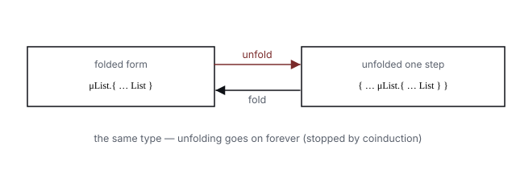

# The Seasoned chibirigor Part 4 — Recursive types: μ and coinduction

> References (optional): TAPL ch. 20 "Recursive types," ch. 21 "Metatheory of recursive types" /
> 『しくみ』 ch. 8. We treat recursive types, where a type references *itself*, and contrast Rigor's
> alternative answer (HKT / `App`, with cycle detection and a fuel safety net).

In the previous Part 3 we saw generics and type substitution — the contrivance where one type *takes
another type as an argument.* The recursive types treated this chapter are structures where a type
calls in *itself*, argument-like.

The Little volume handled arrays and hashes as *finite* structures, but real data includes things
that contain themselves — JSON, trees, linked lists, streams. These types **reference themselves.**

---

## 4-1. Why recursive types are needed

The most familiar example is **JSON.** The value `JSON.parse` returns is:

```
value = null | bool | number | string | Array[value] | Hash[String, value]
```

`value` appears within `value`'s definition. With the Little volume's type carriers, we couldn't
write this "type containing itself." Trees and lists are the same:

```ruby
# linked list: nil, or [element, rest of the list]
list = nil | [Integer, list]
```

To hold these properly as types, **recursive types** are needed.

---

## 4-2. μ-types — notation that folds the recursion

The standard notation for a recursive type is the **μ (mu) type.** `μX. T` represents "the type with
`X` in `T` replaced by `μX.T` itself." For example, `list` is:

```
μList. (nil | [Integer, List])
```

`X` (and `List`) is a **type variable** — "the hole where itself goes." Unlike the generics type
variables of Part 3, here it points to "the position where itself goes in the recursion."

**Unfold:** a μ-type can be *unrolled one step* by substituting itself for the variable.

```
μList.(nil | [Integer, List])
  =  nil | [Integer, μList.(nil | [Integer, List])]   (one-step unfold)
```

```text
   folded form                    unfolded one step
   ┌─────────────────┐  unfold →  ┌──────────────────────────────┐
   │ μList.{ … List } │  ─────────  │ { … μList.{ … List } }        │
   └─────────────────┘  ← fold     └──────────────────────────────┘
        (they point to the same type. unfolding can go on forever — so the equivalence test needs a way to stop)
```


> ▼ Figure 4-1 — fold and unfold of a μ-type. Both are the same type. Unfolding goes on without
> limit, so the equivalence test needs a "way to stop" (§4-4's coinduction).

The folded form and the one-step-unfolded form represent **the same type** — but *as data structures
they're different things.* How to handle this "fold/unfold are equal" is the core of implementing
recursive types.

---

## 4-3. Equi-recursive vs. iso-recursive

Recursive types come in two manners (TAPL 20.2):

- **Iso-recursive:** the user *explicitly marks* where to fold / unfold (`fold`/`unfold`). The
  implementation is easy (the equivalence test doesn't chase the recursion), but the writing side is
  bothered.
- **Equi-recursive:** the folded form and the unfolded form are *equal as is.* Easy to write with no
  annotations, but the equivalence test is hard to implement (it needs to chase the recursion).

TypeScript and most practical languages adopt **equi-recursive**, and 『しくみ』 ch. 8 implements this
side too. Because it's intuitive. ML-family languages are often iso-recursive (for affinity with
other features).

---

## 4-4. Termination of the equivalence test, and coinduction

The hard spot of equi-recursive is that **the type equivalence test doesn't terminate.** Trying to
check whether `μX.{foo:X}` and `μY.{foo:Y}` are equal — unfold X, unfold Y, compare inside `foo` →
back to the original comparison → infinite loop.

The solution is **coinduction = an assumption set.** Remember "the pair currently being compared" in
a set `seen`, and **if asked the same pair again, assume "equal" and cut it off.** In running Ruby,
it looks like this (types: base = `Symbol`, record = `Obj`, μ = `Rec`, type variable = `Var`):

```ruby
# equivalence test treating folded and unfolded forms as equal.
# seen is "the pair currently being compared." If asked the same pair again, assume true and stop (coinduction).
def type_eq(s, t, seen = [])
  return true if seen.any? { |s2, t2| naive_eq(s2, s) && naive_eq(t2, t) }
  return type_eq(unfold(s), t, seen + [[s, t]]) if s.is_a?(Rec)
  return type_eq(s, unfold(t), seen + [[s, t]]) if t.is_a?(Rec)

  case [s, t]
  in [Symbol, Symbol] then s == t
  in [Obj, Obj]
    s.fields.size == t.fields.size &&
      s.fields.all? { |k, v| t.fields.key?(k) && type_eq(v, t.fields[k], seen) }
  else false
  end
end
```

The `naive_eq` used in the `seen` check is **α-equivalence that absorbs only bound-variable-name
differences** (no unfolding) — to treat `μX.{foo:X}` and `μY.{foo:Y}` as "the same," it carries
around a name correspondence table `map`. This is **the same technique** as the α-equivalence that
appeared in Part 3's generics ("one at the root" = bound-variable names aren't essential). The whole,
including this `naive_eq`/`unfold`/`subst`, is in the standalone design sketch
[`examples/mu_typeeq.rb`](examples/mu_typeeq.rb), where `ruby mu_typeeq.rb` goes **green**:

```text
PASS: muX{foo:X} == muY{foo:Y} (α + cycle)
PASS: muX{foo:X} == {foo: muX{foo:X}} (fold/unfold)
PASS: muX{foo:X} != muY{bar:Y} (field name)
PASS: stream fold == unfold (α)
PASS: Num == Num
PASS: Num != Bool
```

"The very thing you're trying to prove, if asked again midway, grant that it holds" — this is the
heart of coinduction. TAPL ch. 21 develops this algorithm and its correctness (subtyping as the
greatest fixed point).

> [!NOTE]
> **To be precise:** this sketch puts each pair into `seen` *before* unfolding it, and matches against
> `seen` with `naive_eq` (α-equivalence of bound variables, a comparison **without unfolding**). That
> is the same shape as TAPL ch. 21's coinductive decision algorithm, and it catches the same
> "equals." What differs is that it handles only equivalence, not subtyping, and that sibling record
> fields don't share the assumption set.
>
> **Reference note.** 『しくみ』 ch. 8 illustrates *why* naive unfolding doesn't terminate, with
> single recursion (Figure 8.2) and mutual recursion (Figure 8.3), and solves it with a `typeEqSub`
> holding `seen`. TAPL ch. 21 is its theoretical background (coinduction, greatest fixed point).

---

## 4-5. A note: Rigor's alternative answer — HKT / `App`, cycle detection, and fuel

Rigor doesn't implement recursive types *directly* with μ + coinduction. Instead it uses a
**lightweight HKT (higher-kinded type)** (`Type::App`). `JSON.parse`'s return is an *opaque*
higher-order type application `App[:"json::value", [String]]` (taking the key type as an argument,
arity 1), **reduced** to the registered body when needed:

```
App[:"json::value", [String]]
  → Value = Literal | Array[Value] | Hash[String, Value]   (reduce to a recursive union)
```

What stops reduction is mainly **cycle detection** on the reduction stack. If reduction meets the
same `(URI, arguments)` application again partway through, it returns the `App` being unfolded
as is and ties the knot (ADR-20 D4). Like μ-folding, this is an *exact* stop on the side that
*builds* the type. It is a different thing from `seen`, which decides a relation between two types
by coinduction; Rigor defers acceptance *into* an `App` to `bound` (see below), so nothing there plays
the role of `seen`. Any unfolding that still doesn't stop is cut off, approximately, by the outer
safety net: the **fuel budget.**

So to the same problem — "how do we stop the unfolding of recursion?" — 『しくみ』/TAPL answer
*theoretically* (a correct equivalence test by coinduction), and Rigor *in engineering* (an exact
stop at a cycle, with fuel behind it). **Seasoned Part 7, which treats soundness, gathers this
engineering of termination in one place** (read together with gradual's settling).

> [!NOTE]
> **Passing `symbolize_names: true` as a literal changes the type**
>
> `JSON.parse`'s type depends on the argument options. In particular, when the `symbolize_names:` key
> is passed as the literal `true`, Rigor switches the post-reduction type:
>
> ```ruby
> JSON.parse(s)
> # => App[:"json::value", [String]]
> #    reduce: Literal | Array[json::value[String]] | Hash[String, json::value[String]]
>
> JSON.parse(s, symbolize_names: true)
> # => App[:"json::value", [Symbol]]   ← same URI, only the key type argument becomes Symbol
> #    reduce: Literal | Array[json::value[Symbol]] | Hash[Symbol, json::value[Symbol]]
> ```
>
> What decides this is a **lookup table** built into Rigor. For a handful of standard-library methods
> whose upstream RBS can't simply be overridden, Rigor ships a table of return types. The
> `JSON.parse` entry makes the key type argument `Symbol` (`App[:"json::value", [Symbol]]`) only when
> the call site's second argument is a `HashShape` and its `symbolize_names:` value is the literal
> `true` (`Const[true]`); with `false` or a variable (`untyped`) it returns to the default `String`
> version. Note that what the caller sees is the reduced form. Only the outer layer is reduced,
> though: nested recursive parts stay in `App` notation, like `json::value[String]`.
>
> This "the argument's literal value decides the type" is an example of the Little volume's `Const`
> at work. The same mechanism as `HashShape`'s key read (the `:foo` in `h[:foo]` is a literal) is used
> for HKT type-argument selection too. And since reduction could unfold forever, it's stopped on
> the safe side as described above — cycle detection first, **fuel (default 64)** as the backstop.

> [!TIP]
> **Reference note.** What backs an `App` that stays unreduced is not ch. 20/21 on recursive types
> but **TAPL ch. 29 "Type operators and kinding"** — the primary grounds for HKT (a type that takes
> a type and returns a type). The
> well-formedness of a type application like `App[F, A]` is guaranteed by ch. 29's framework that
> attaches a *kind* to types. Rigor's lightweight HKT is its defunctionalized implementation version.

> [!NOTE]
> **Acceptance into an `App` is deferred to its upper bound `bound`**
>
> When `App[F, A]` is the expected type and Rigor is asked whether it accepts `T`, it doesn't try
> reduction on the spot. It defers the verdict to the **upper bound `bound`** fixed at registration
> time, and a reduction that runs out of fuel falls back to that `bound` too. Judging by the upper
> bound is an approximation from above, so it errs toward passing. `bound` defaults to `untyped`
> (`Dynamic[Top]`), and real Rigor answers `:yes` when the expected type is `Dynamic`, so an `App`
> registered without an upper bound lets anything through when it's the expected type.
>
> The other direction is a different story. Pass an `App` that stayed unreduced *as an argument*, and
> today it isn't routed through `bound`: the expected type's ordinary rules judge it, so passing a
> `json::value[String]` to a `String` parameter is rejected.
>
> The judgment itself uses **the same framework** as the three values (`:yes/:no/:maybe`) of
> `accepts` implemented in Little Part 7. But "mix in `untyped` and you get `:maybe`" is
> chibirigor's simplification; real Rigor answers `:yes` when one side is wholly `untyped` (the
> difference is gathered in the note in Seasoned Part 7 §7-5).
>
> | Where the type is unknown | chibirigor's `accepts` | real Rigor |
> |---|---|---|
> | one side is wholly `untyped` | `:maybe` | `:yes` (let through, gradual) |
> | passing a Union with an `untyped` arm | folded to `untyped` as a whole → `:maybe` | judged member by member (can be `:no`) |
> | an `App` whose upper bound `bound` is still the default `untyped`, as the expected type | (no HKT) | `:yes` (let through, gradual) |
>
> Where the type is wholly unknown, both pass quietly. HKT's complexity hides behind `bound`, and the
> caller of `accepts` need only think about the meaning of the three values — the cleanness of the
> design.

---

## 4-6. We didn't build it in chibirigor's main volume

The Little volume made recursive types **out of scope** (Little Part 6 handled `HashShape`/`Tuple` as
finite, and declared HKT / `App` and fuel unimplemented). The reason is the complexity budget — μ +
coinduction and HKT + fuel both depart from the minimal version's gist (bidirectional + gradual +
flow). Recovering them *as concepts* in the Seasoned volume was the right call.

If we were to add a minimal implementation: add `Rec(name, body)` and `TypeVar(name)` to the type
carriers, and hold `seen` in `accepts`/the equivalence test — this is the minimal form of μ +
coinduction (a Ruby port of 『しくみ』 ch. 8). The HKT version is a separate implementation with a URI
reference, cycle detection, and fuel.

---

## 4-7. Summary

| Point | Key |
|---|---|
| Why recursive types | JSON, trees, lists, streams are **recursive types** where a type references itself |
| μ-types | fold the recursion, unroll one step by unfold. fold/unfold are the same type |
| The two manners | **equi-recursive** (no annotation / hard to implement) vs. **iso-recursive** (annotation needed / easy to implement). Practical usage is mostly equi-recursive |
| Equivalence test | doesn't terminate → cut off with **coinduction (`seen` assumption set)** (TAPL ch. 21) |
| Rigor's alternative | **HKT / `App`, cycle detection + fuel** (HKT's grounds are TAPL ch. 29): stop reduction *exactly* with **cycle detection**, and cut it off *approximately* with a *fuel budget* as the outer safety net; acceptance *into* an `App` is deferred to the upper bound `bound` (the termination-engineering sum-up is Part 7) |

## Exercises

1. **Trace fold/unfold:** trace by hand that `μX.{foo:X}` and `{foo: μX.{foo:X}}` (one-step unfold)
   are equal, following `examples/mu_typeeq.rb`'s `type_eq` (write one pair that enters `seen`).
2. **Why it stops:** state what happens in the `μX.{foo:X} == μY.{foo:Y}` test if you didn't use
   `seen`, and explain in one sentence how `seen` cuts the infinite loop.
3. **Theory vs. engineering:** compare the three ways to stop the unfolding of recursion —
   "coinduction (`seen`)," "cycle detection," and "fuel budget" — and sort out which are exact
   stops and which is an approximation. Then state why a practical checker (Rigor) keeps a fuel budget as an
   outer safety net on top of cycle detection (gradual's settling).

**Next chapter (Part 5):** we extend the Little volume's naive type inference to Rigor's real **type
inference.** We treat unification — collecting constraints on argument types from how the body uses
them, then solving them — and gather in one place the comparison with TypeProf, which collects types
from the callers.

---

> **This chapter's design sketch** → [`examples/mu_typeeq.rb`](examples/mu_typeeq.rb) (self-checks with `ruby mu_typeeq.rb`)
